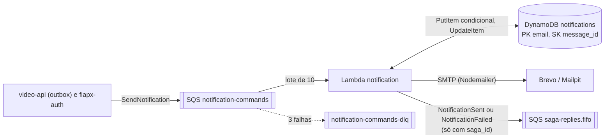

# fiapx-notification

Notificação do FIAP X: fila SQS → Lambda que envia e-mail por SMTP (provedor externo, padrão Brevo), registra cada envio no DynamoDB (chave = e-mail) e responde à SAGA.

> Parte do **Hackathon FIAP X — Processador de Vídeos** (PÓS TECH SOAT, Fase 5).
> Etapa 6 implementada (código, testes e Terraform); deploy pelo GitHub Actions em `deploy.yml`. A
> documentação vem antes do código: a arquitetura, as decisões (ADRs/RFCs) e os contratos ficam em
> [`fiapx-docs`](https://github.com/hackathon-fiap-soat/fiapx-docs).

## Stack

Node.js 24 (CommonJS) · Nodemailer (SMTP; Mailpit no ambiente local) · AWS SDK v3 (DynamoDB, SQS, SSM,
Secrets Manager) · Ajv (JSON Schema 2020-12) · Jest · ESLint · Terraform (AWS provider 6.x)

## Como funciona

Especificação em `fiapx-docs/00-especificacao/Projeto-hackton.md` §8.6,
[ADR-013](https://github.com/hackathon-fiap-soat/fiapx-docs/blob/main/04-adrs/ADR-013-notificacao-sqs-lambda-ses-e-historico-no-dynamodb.md),
[ADR-017](https://github.com/hackathon-fiap-soat/fiapx-docs/blob/main/04-adrs/ADR-017-recuperacao-e-troca-de-senha.md) e
[ADR-019](https://github.com/hackathon-fiap-soat/fiapx-docs/blob/main/04-adrs/ADR-019-deploy-na-aws-academy-learner-lab.md).



1. O event source mapping entrega lotes de até 10 mensagens; o handler responde no formato
   `ReportBatchItemFailures`: só as mensagens que precisam de nova tentativa voltam para a fila.
2. O comando é validado contra o JSON Schema `SendNotification` v1 (consumidor tolerante: campo desconhecido
   não invalida). Payload inválido é gravado como `FAILED` e não é reenviado; se tiver `saga_id`, a SAGA
   recebe `NotificationFailed`.
3. **Idempotência:** `PutItem` com status `PENDING` e condição `attribute_not_exists(message_id) OR
   #status = :failed` (spec §8.6.3). Se o item já está `SENT`, não reenvia: só repete o `NotificationSent`.
   Se está `PENDING` (outra execução enviando), a mensagem volta para a fila.
4. Envia por SMTP e grava `SENT`, `provider_message_id` (Message-ID do envio) e `sent_at`. Responde
   `NotificationSent` na `saga-replies.fifo` (`MessageGroupId = saga_id`, `MessageDeduplicationId =
   message_id`) **só quando `saga_id` não é nulo**: os e-mails de senha ficam fora da SAGA.
5. Falha no SMTP: `FAILED`, `attempts` e `last_error`, e a mensagem volta para a fila. Na 3ª tentativa
   (`ApproximateReceiveCount` = 3), a SAGA recebe `NotificationFailed` e a mensagem segue para a DLQ.

Modelos em pt-BR (HTML + texto) em `src/templates/`:

| Modelo | Assunto | Botão |
|---|---|---|
| `VIDEO_FAILED` | Não conseguimos processar o vídeo `<nome>` (com o motivo legível, ex.: `FFMPEG_ERROR`) | site (`/fiapx/<env>/web/url`) |
| `VIDEO_COMPLETED` | Seu vídeo `<nome>` está pronto | site |
| `PASSWORD_RESET` | Redefinição de senha do FIAP X | `action_url` do comando |
| `PASSWORD_CHANGED` | Sua senha do FIAP X foi alterada | `<site>/recuperar-senha` |

O `action_url` (link com o token de redefinição) só existe em memória: nunca vai para o DynamoDB nem
para o log.

### Decisões de implementação

- **Resposta com `message_id` determinístico:** o id do `NotificationSent`/`NotificationFailed` é um UUID v7
  derivado do `message_id` do comando e do tipo da resposta. Repetir a resposta (duplicata ou nova
  tentativa) gera o mesmo id, que a FIFO deduplica e o `video-api` reconhece como já processado.
- **`PENDING` abandonado:** além da condição da spec, um `PENDING` com `updated_at` mais antigo que 60 s
  (o visibility timeout da fila) pode ser retomado, para o caso de a Lambda morrer entre a reserva e o envio.
- **`created_at`** é o `occurred_at` do comando (estável entre tentativas), e `attempts` é o
  `ApproximateReceiveCount` da mensagem.
- **Schemas em tempo de execução:** a Lambda valida com uma cópia de `envelope.schema.json` e
  `send-notification.v1.schema.json` em `src/contracts/`. O contract test falha se a cópia divergir do
  `fiapx-docs`; para atualizar, `npm run contracts:sync`.

## Estrutura

```text
src/domain/          Notification, Recipient, Email, NotificationStatus, Template, motivos legíveis
src/application/     SendNotification (caso de uso) e portas (ports.js)
src/infrastructure/  config (env ou SSM), DynamoDB, SMTP (Nodemailer), SQS, templates, schemas, ids, container
src/templates/       modelos pt-BR (.html e .txt) e catálogo (assunto e link)
src/contracts/       cópia dos schemas do fiapx-docs usados em tempo de execução
src/handlers/        sqs-handler.js (entrada da Lambda)
scripts/             build.sh (zip), dev-consumer.js (consumidor local), sync-contracts.sh
tests/               unit/, contract/ (schemas do fiapx-docs) e integration/ (LocalStack + Mailpit)
infra/               Terraform: fila + DLQ + alarme, tabela, Lambda (LabRole), event source mapping, segredo SMTP
```

## Como rodar

Pré-requisitos: Node.js 24 (`.nvmrc`), Docker e os repositórios `fiapx-infra` e `fiapx-docs` clonados ao
lado deste.

```bash
# 1. Ambiente local (MySQL + LocalStack + Mailpit); o init cria a fila, a tabela, o segredo SMTP e o SSM
(cd ../fiapx-infra/local && docker compose up -d --wait)

# 2. Dependências e variáveis
npm ci
cp .env.example .env && set -a && . ./.env && set +a

# 3. Consumidor local: lê a fila notification-commands como o event source mapping e chama o handler
npm run dev
```

Com o consumidor de pé, os e-mails chegam ao Mailpit (`http://localhost:8025`) e o fluxo local do
`fiapx-video-api` termina em `NOTIFIED`. Para mandar um comando à mão:

```bash
url=$(aws ssm get-parameter --name /fiapx/local/sqs/notification-commands/url --query Parameter.Value --output text)
aws sqs send-message --queue-url "$url" --message-body file://../fiapx-docs/contracts/examples/send-notification.v1.json
```

## Como testar

```bash
npm run lint
npm test                    # unitários e de contrato (sem Docker)
npm run test:integration    # integração com o ambiente local de pé
npm run test:coverage       # tudo, com cobertura mínima de 80% (é o que o CI roda)
npm run build               # dist/fiapx-notification.zip
```

- Os contract tests consomem os exemplos de `../fiapx-docs/contracts/examples` (ou `CONTRACTS_DIR`),
  validam as respostas produzidas contra `notification-sent.v1` e `notification-failed.v1` e conferem que a
  cópia dos schemas em `src/contracts/` está igual à do `fiapx-docs`. No CI, o workflow faz checkout do
  `fiapx-docs` ao lado.
- A integração usa o handler da Lambda com o DynamoDB, o SSM e o Secrets Manager do LocalStack e o SMTP do
  Mailpit: confere o e-mail na API do Mailpit, o item `SENT` com PK = e-mail, a resposta na FIFO (uma fila
  própria do teste, para não disputar a `saga-replies.fifo` com o `video-api`) e que a duplicata não gera
  segundo e-mail.

## Variáveis de ambiente

| Variável | Uso | Padrão |
|---|---|---|
| `FIAPX_ENV` | Prefixo dos parâmetros `/fiapx/<env>/...` | `local` |
| `AWS_ENDPOINT_URL` | Endpoint da AWS (LocalStack no ambiente local) | — |
| `NOTIFICATION_TABLE_NAME` | Tabela de histórico | SSM `dynamodb/notifications/table_name` |
| `SAGA_REPLIES_QUEUE_URL` | Fila `saga-replies.fifo` | SSM `sqs/saga-replies/url` |
| `WEB_URL` | Base dos links dos e-mails | SSM `web/url` |
| `SMTP_HOST`, `SMTP_PORT` | Servidor SMTP (no local, `SMTP_HOST=localhost`: o SSM diz `mailpit`, que só resolve dentro do compose) | SSM `notification/smtp_host`, `notification/smtp_port` |
| `SMTP_SECRET_ARN` | Segredo `fiapx/<env>/notification/smtp` (JSON `{user, password, from}`) | SSM `notification/smtp_secret_arn` |
| `MAX_ATTEMPTS` | Tentativas até a DLQ (igual ao `maxReceiveCount`) | `3` |
| `NOTIFICATION_QUEUE_URL` | Fila lida pelo `npm run dev` | SSM `sqs/notification-commands/url` |

Sem usuário no segredo (Mailpit), o envio é sem autenticação. Com usuário (Brevo), a porta 587 exige
STARTTLS; a 465 usa TLS direto. O remetente aparece como "FIAP X".

## Infraestrutura (`infra/`)

- Fila `fiapx-<env>-notification-commands` (Standard, visibility 60 s, retenção 4 dias) com DLQ após 3
  recebimentos e alarme da DLQ no tópico SNS do `fiapx-infra`.
- Tabela `fiapx-<env>-notifications` (PK `email`, SK `message_id`, LSI `email-created_at-index`, TTL
  `expires_at`, PITR). Sem bloco `server_side_encryption`: fica com a criptografia padrão da AWS, porque a
  chave `aws/dynamodb` não funciona na AWS Academy.
- Lambda `fiapx-<env>-notification` (`nodejs24.x`, arm64, 256 MB, timeout 30 s) com a `LabRole`, na VPC
  (`vpc/private_subnet_ids`, `vpc/lambda_security_group_id`): o SMTP sai pelo NAT. Log group com retenção de
  14 dias. Precisa (o que uma role própria teria): `dynamodb:PutItem/UpdateItem/GetItem` na tabela,
  `sqs:ReceiveMessage/DeleteMessage` na fila, `sqs:SendMessage` na `saga-replies.fifo` e
  `secretsmanager:GetSecretValue` no segredo SMTP.
- Event source mapping da fila com `batch_size = 10`, `function_response_types = ["ReportBatchItemFailures"]`
  e no máximo 5 execuções simultâneas (protege a cota do provedor).
- Segredo `fiapx/<env>/notification/smtp` (chave padrão do Secrets Manager, sem janela de recuperação para
  o ambiente poder ser recriado) com os valores das variáveis sensíveis `smtp_user`, `smtp_password` e
  `smtp_from`. Sem `smtp_from`, o apply não quebra: o remetente vira
  `configure-o-secret-SMTP_FROM@fiapx.invalid` e os envios falham com o erro em `last_error`.
- Publica no SSM: `sqs/notification-commands/url`, `/arn`, `sqs/notification-commands-dlq/url`,
  `dynamodb/notifications/table_name`, `notification/smtp_host` (`smtp-relay.brevo.com`),
  `notification/smtp_port` (`587`) e `notification/smtp_secret_arn`.
- Lê do SSM: `sns/alerts_topic_arn`, `vpc/private_subnet_ids`, `vpc/lambda_security_group_id`,
  `sqs/saga-replies/url` e `web/url`.

## Deploy

- `deploy.yml`: em todo merge na `main` e quando o `deploy-all` do `fiapx-infra` chama (ADR-018). Gera o
  pacote (`npm run build`), roda `terraform apply` em `infra/` (state `fiapx-notification/prod.tfstate` no
  bucket `fiapx-tfstate-<account_id>`) e confere a Lambda e o event source mapping. Com o ambiente
  destruído, falha ao ler o SSM.
- Secrets: `AWS_ACCESS_KEY_ID`, `AWS_SECRET_ACCESS_KEY` e `AWS_SESSION_TOKEN` (sessão da AWS Academy) e
  `SMTP_USER`, `SMTP_PASSWORD` e `SMTP_FROM` (conta do time no Brevo), passados ao Terraform como
  `TF_VAR_smtp_*`. **Chamado pelo `deploy-all` (`secrets: inherit`), o workflow recebe os Secrets do
  `fiapx-infra`**: os três `SMTP_*` precisam estar lá também (ou na organização); sem eles o deploy avisa e
  grava credenciais vazias.
- `destroy.yml`: chamado pelo `destroy-all` (cria um zip vazio, porque a variável `lambda_zip` exige o arquivo).
- `ci.yml`: lint, testes com cobertura (com `fiapx-docs` e `fiapx-infra` lado a lado e o compose local),
  build do zip e `terraform fmt -check`/`validate` em todo PR.

## Links

- Documentação: [`fiapx-docs`](https://github.com/hackathon-fiap-soat/fiapx-docs)
- Contratos: [`fiapx-docs/contracts`](https://github.com/hackathon-fiap-soat/fiapx-docs/tree/main/contracts)
- Todos os repositórios: [hackathon-fiap-soat](https://github.com/hackathon-fiap-soat)

## Contribuição

- A branch `main` é protegida: toda mudança entra por Pull Request (a aprovação é opcional; qualquer integrante, inclusive o autor, pode fazer o merge).
- O `README.md` deve estar sempre atualizado: toda mudança que afete propósito, stack, como rodar/testar,
  variáveis de ambiente ou links atualiza este arquivo no mesmo PR.
- Nunca commitar segredos (`.env`, chaves, tokens). Use `.env.example` com valores fictícios.
- Contexto para o Claude Code: [`CLAUDE.md`](CLAUDE.md) (projeto, regras e o papel deste repositório) e skills em
  [`.claude/skills/`](.claude/skills/) com os procedimentos deste repositório.

## Licença

[MIT](LICENSE)
